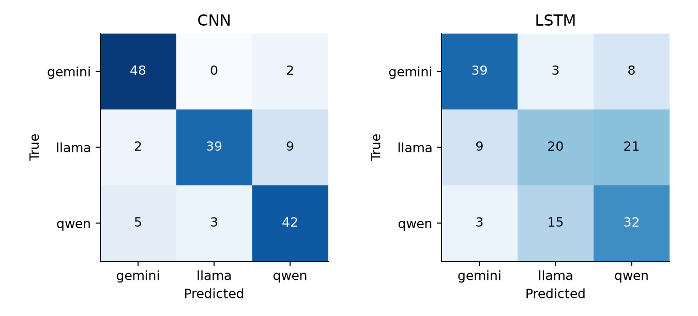
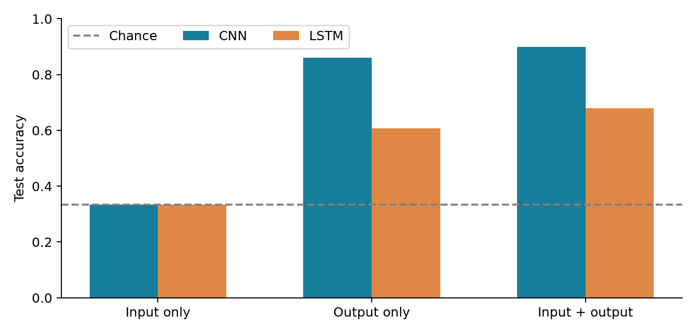
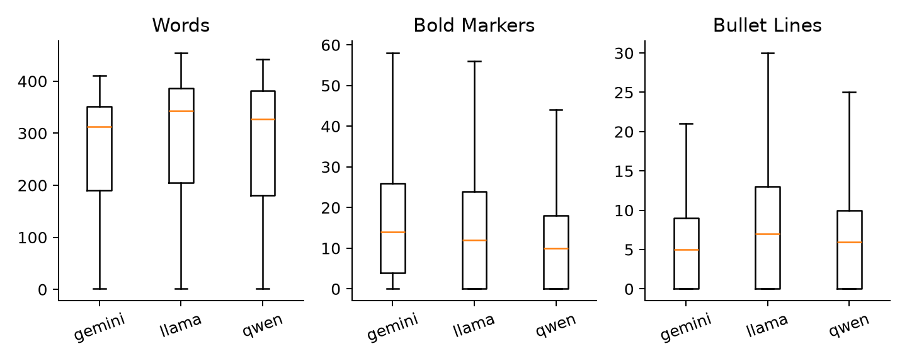

448 PROJECT 1  /  EXPERIMENT REPORT

Identifying LLM authors
from generated text

CNN and LSTM attribution across Llama, Gemini, and Qwen

Team: Adithya Vemulapali, Shreya Garg, Ani Ganesan

Team leader: Not yet designated (at the team's request).

Report generated October 11, 2026.

Abstract

We investigate whether small neural classifiers can attribute a response to one of three LLM families using a balanced corpus of 1,500 outputs elicited by 500 shared prompts. A prompt-grouped, category-balanced split prevents the same prompt from appearing in training and evaluation. On the 150-example test set, the output-only CNN achieved 86.0% accuracy and the LSTM achieved 60.7%. Both input-only models scored exactly 33.3%, as expected for identical prompts with balanced labels. We also evaluated input-plus-output models, initialization robustness, held-out writing tasks, and structural-feature ablations. These measurements establish separability within this dataset, not universal or reliable forensic identification of arbitrary text.

| Research question | Evidence included |
|---|---|
| RQ1: Which model wrote it? | CNN/LSTM accuracy, macro-F1, per-family recall, confusion matrices, three output-only seeds. |
| RQ2: Does the prompt help? | Input-only, output-only, and input + output under one shared split. |
| RQ3: Unseen tasks? | Four held-out writing categories; source-only checkpoint selection. |
| RQ4: Which signals matter? | Length/formatting summaries, diagnostic baselines, retrained formatting ablations. |

Repository: https://github.com/adithyavemulapalli/448-project-1

1  Dataset and provenance

| Family label | Recorded model | Responses / source |
|---|---|---|
| llama | llama3.1:8b | 500 / Ollama |
| gemini | gemini-3.8-flash | 500 / Gemini API collector |
| qwen | qwen2.5:7b (Q4_K_M) | 500 / Ollama on Mac and RTX 4070 |

The repository master file contains 500 unique prompts: 25 in each of 20 categories. The same prompt text is paired with each family. Every record supplies model_family, model_name, prompt_id, prompt_category, prompt, output, requested temperature/max_tokens, and timestamp. Ollama rows additionally record the endpoint. The repository contains collected generations, not scraped third-party conversations. The original prompt-authoring procedure was not logged; no claim of independently verified prompt originality is made.

Coverage

Categories: explanations; creative fiction; poetry; humor; how-to; recipes; code generation; code debugging; math; riddles; summarization; translation/language; opinions/debate; marketing copy; business writing; history; science; philosophy/ethics; advice; travel.

Collection controls and limits

All records request temperature 0.7 and a 512-token generation cap. This cap does not equalize length across tokenizers or prevent truncation. The Gemini collector requests thinking_budget=0, but thought-token usage was not saved, so actual enforcement cannot be verified. Model names are recorded collection labels; the saved text alone is not independent proof of backend identity.

Qwen used one verified model digest across the M2 Pro Mac and desktop RTX 4070. Execution moved from local sequential to two local workers, then to remote sequential and finally one worker on each machine. Production had no fixed seed; original saved responses were preserved. Hardware/runtime stages correlate with prompt order, limiting attribution of domain effects. Full provenance is in DATASET_CAVEATS.md and the collection event/metrics sidecars.

Audit findings and handling

All 1,500 records passed unique-ID, prompt/category alignment, nonempty-output, and requested-setting checks. No exact duplicate prompts or outputs were found after whitespace/case normalization; semantic near-duplicates were not exhaustively checked. Qwen response 84 mentions its own name: model names are masked consistently in neural preprocessing. Gemini response 51 contains only two haiku lines and is retained as observed. Of 153 Qwen records with saved finish metadata, 84 reached the cap; this is not a corpus-wide rate. The rejected Pollinations dataset is excluded. Raw data remains unchanged.

2  Experimental design and implementation

Main split: 400/50/50 prompt IDs for train/validation/test (1,200/150/150 examples). Each category contributes 20 training prompts; its other five are allocated 2/3 or 3/2 to validation/test, giving 50 each overall. All three responses to a prompt stay together. Splits use seed 42 and are persisted. Vocabulary is built only from the training partition, with minimum token frequency 2.

Tokenization preserves Unicode words, punctuation, and newlines, then lowercases text and masks model names. Output-only uses the first 256 tokens; input-only uses the first 64 prompt tokens. Input + output concatenates up to 64 prompt tokens, a separator, and the same 256 response tokens. Thus prompts do not displace response text. Unknown words map to a dedicated token. Sequence lengths and padding masks are tracked explicitly.

| Component | CNN | LSTM |
|---|---|---|
| Embedding | Random, 128 dimensions | Random, 128 dimensions |
| Encoder | 64 filters per width 3/4/5; ReLU; masked max pooling | One unidirectional layer, 128 hidden units |
| Readout | Concatenated 192-dimensional pooled vector | Hidden state at last real token |
| Head | Dropout 0.4 + three logits | Dropout 0.4 + three logits |
| Output-only parameters | 1,313,283 | 1,346,691 |

Both models use AdamW (learning rate 0.001, weight decay 0.01), cross-entropy loss, batches of 32, gradient norm clipping at 1.0, and up to 15 epochs. Early stopping uses validation loss with patience 4 and minimum improvement 0.0001. A cloned best checkpoint is restored before test evaluation. There was no hyperparameter search or selection on test accuracy. A unidirectional LSTM was chosen so gathering the last real state excludes right padding and runs efficiently on MPS. CNN trailing padded windows cannot win max pooling.

All 14 experiments ran on the M2 Pro GPU using PyTorch 2.14.1. Output-only seeds 7 and 123 supplement the primary seed 42 with an unchanged split. Test accuracy intervals resample complete prompt triplets (2,000 draws); paired ablation differences use 5,000 draws. These intervals do not capture uncertainty over all model versions or dataset collection procedures. Seed repetitions reuse the same test set.

Implementation checks cover group separation, category/family balance, Unicode retention, identity masking, matched response budgets, padding invariance, finite gradients, and immutable saved checkpoints. A separate verifier recomputes metrics from predictions, reconstructs vocabularies from training rows, and checks hashes and checkpoint selection.

3  RQ1: Can responses identify their authors?

| Model | Accuracy [95% interval] | Macro-F1 | Best epoch |
|---|---|---|---|
| CNN | 86.0% [79.3% - 92.0%] | 0.859 | 15 |
| LSTM | 60.7% [52.7% - 68.7%] | 0.601 | 6 |

Confusion matrices use true families as rows and predictions as columns; each row contains 50 examples. Per-family accuracy is recall within that family, not precision. All primary models use masked output text.

| Model | Gemini recall | Llama recall | Qwen recall |
|---|---|---|---|
| CNN | 96.0% | 78.0% | 84.0% |
| LSTM | 78.0% | 40.0% | 64.0% |

| Model | Seed 42 | Seed 7 | Seed 123 | Mean +/- SD (pp) |
|---|---|---|---|---|
| CNN | 86.0% | 88.0% | 88.7% | 87.6 +/- 1.4 |
| LSTM | 60.7% | 66.7% | 52.7% | 60.0 +/- 7.0 |

Performance above the 33.3% balanced baseline supports attribution within this collection. Differences between architectures may reflect local formatting cues, how information is pooled, and optimization, not an intrinsic advantage on every authorship problem. The repeated seeds measure initialization/training variability only. No seed was selected retrospectively as the headline result.

4  RQ2: Does the user prompt help?

| Model | Text source | Accuracy | Macro-F1 |
|---|---|---|---|
| CNN | input | 33.3% | 0.332 |
| CNN | output | 86.0% | 0.859 |
| CNN | both | 90.0% | 0.900 |
| LSTM | input | 33.3% | 0.298 |
| LSTM | output | 60.7% | 0.601 |
| LSTM | both | 68.0% | 0.669 |

Input-only accuracy is exactly one third for both architectures. Each unseen prompt occurs three times with identical text and three different balanced labels; a deterministic model makes one prediction for all three, so exactly one is correct. This is stronger than a statistical expectation of chance and acts as a pipeline check. Input-only macro-F1 can differ from one third because the model can favor some labels.

Adding prompts changes CNN accuracy by +4.0 percentage points (paired 95% interval +1.3 to +7.3) and LSTM accuracy by +7.3 percentage points (paired 95% interval +0.0 to +15.3). The comparison uses paired prompt groups. A range crossing zero does not support a clear improvement from this test sample.

Identical prompts cannot reveal the family by themselves, but may help interpret response style conditional on the task. Including them also lengthens the sequence and changes vocabulary/optimization. Consequently, either improvement or degradation is possible; output-only performance is not a theoretical upper bound.

5  RQ3: Do fingerprints transfer across tasks?

This extra-credit experiment excludes creative fiction, poetry, marketing copy, and business writing from training and validation. The remaining 16 categories provide 320 training, 40 validation, and 40 source-test prompts (960/120/120 examples). The held-out writing set contains 100 prompts and 300 responses. Each model is trained from scratch on source output text only, seed 42. Vocabulary and checkpoint selection use source data exclusively.

| Model | Source test | Unseen writing | Change (pp) | Target macro-F1 |
|---|---|---|---|---|
| CNN | 92.5% | 64.3% | -28.2 | 0.625 |
| LSTM | 64.2% | 50.3% | -13.8 | 0.496 |

| Model | Target Gemini | Target Llama | Target Qwen | Target accuracy 95% CI |
|---|---|---|---|---|
| CNN | 84.0% | 75.0% | 34.0% | 59.3% - 69.0% |
| LSTM | 69.0% | 41.0% | 41.0% | 45.7% - 55.0% |

The target test set is wholly unseen by task category, and therefore tests transfer beyond new prompts in familiar categories. Source and target samples differ in size and difficulty. Their accuracy difference is descriptive: it does not isolate domain as a causal variable. The source training set is also smaller than in RQ1, so domain results should not be compared directly with the primary test as if training conditions were identical.

Both architectures lose accuracy on unseen writing in these runs. Their above-chance target performance is accompanied by substantial losses, limiting claims of task-independent fingerprints.

Above-chance target performance is consistent with some transferable signals; a decline indicates that part of the learned evidence depends on task mix. It does not prove that any signal is universal to an LLM family. Collection stages, response lengths, and formatting may all contribute. Only four writing categories and one domain-training seed per architecture were tested.

Per-family interpretation

CNN: target recall is highest for gemini (84.0%) and lowest for qwen (34.0%). This difference reflects the particular held-out writing responses; it is not an intrinsic identifiability ranking for all future models.

LSTM: target recall is highest for gemini (69.0%) and lowest for llama (41.0%). This difference reflects the particular held-out writing responses; it is not an intrinsic identifiability ranking for all future models.

6  RQ4: What signals distinguish the outputs?

Distributions describe all 500 responses per family; boxplots hide outliers for readability. Words are Unicode letter/number spans. Lexical diversity is unique-word count divided by word count, so it is length-dependent. These summaries are descriptive and not causal feature attributions.

| Diagnostic model | Test accuracy | Macro-F1 |
|---|---|---|
| Word count only | 33.3% | 0.259 |
| 11 structural/lexical features | 72.0% | 0.712 |

Diagnostic models use standardized logistic regression fitted only on training data. Features are words, characters, lines, blank lines, bullet lines, heading lines, backticks, bold markers, type-token ratio, average word length, and punctuation fraction. They access complete responses, while neural models use capped sequences; they are not exactly input-matched competitors.

| Model | Masked output | Plain words | Difference (pp) |
|---|---|---|---|
| CNN | 86.0% | 66.7% | -19.3 |
| LSTM | 60.7% | 45.3% | -15.3 |

Retraining with punctuation/newlines removed changes CNN accuracy by -19.3 percentage points (paired 95% interval -26.7 to -12.0) and LSTM accuracy by -15.3 percentage points (paired 95% interval -25.3 to -5.3). Both variants already lowercase and mask model names. Removing formatting also allows more words inside the fixed token budget, so the comparison cannot attribute the entire difference solely to punctuation.

Word count alone scored 33.3%, whereas the combined structural/lexical features scored 72.0%. Both neural models lost accuracy after formatting removal. This pattern is consistent with substantial structural information beyond length alone, with the token-budget confound noted above.

7  Limitations, lessons, and experience

What this study does and does not establish

This is a closed-set classification study of three recorded model configurations and one generation setup per family. It does not detect human authorship, handle unknown families, or establish reliability on paraphrased, edited, adversarial, or newly released model outputs. A family label may proxy for the specific model, provider, chat template, formatting defaults, or collection stage. The dataset contains 500 independent prompt groups, not 1,500 independent tasks.

The 512 generation cap leaves some responses incomplete, and the 256-token neural budget further removes text. Short answers and incomplete generations remain in the raw corpus. Missing Gemini finish/thought metadata prevents resolving whether its unusually short haiku reflects normal generation, truncation, or another cause. Similarities between different prompts were not exhaustively audited. Test intervals and initialization repeats cannot compensate for these provenance limits.

Technical lessons from the project workflow

1. Data integrity precedes model complexity. Explicit file selection, family balance, prompt alignment, and checksums prevented silent omissions such as ignoring a JSONL family. The input-only control provides a concrete check against accidental label or metadata leakage.

2. Padding and checkpoint details change what is actually evaluated. A unidirectional LSTM must read the last real token rather than padded timesteps; CNN pooling must exclude trailing padding. Cloning the saved best state prevents later optimization from mutating the intended checkpoint.

3. Equal sampling parameters are useful controls, but do not equalize distributions. Different tokenizers, response lengths, formatting, runtime versions, and execution stages remain possible shortcuts. The length/structure baselines and formatting ablations make some of these visible.

4. Faster hardware improves iteration, but integrity matters during migration. Checkpointing and one writer preserved all saved responses while Qwen collection moved between Mac and PC. The training suite keeps splits and outputs separate for each run, making comparisons reviewable.

5. A successful classifier is not automatically an explanation. Domain transfer and ablations narrow interpretations, but neither proves a universal fingerprint. Reporting negative controls, confidence intervals, and weaker configurations is more informative than reporting only the best seed.

Assistance and responsibility

Codex assisted with collection tooling, auditing, implementation, experiment execution, analysis, and report preparation. These lessons describe the documented workflow rather than invented personal reflections. The named team should review the code, results, report, and course disclosure requirements and be able to explain the submission. The team leader is intentionally not designated yet.

8  Reproducibility and references

Repository: https://github.com/adithyavemulapalli/448-project-1. Raw dataset checksums and collection history are versioned. Each experiment stores configuration, environment, model parameter count, training history, best epoch, data hashes, vocabulary, prompt split, and validation/test predictions. The two primary output-only checkpoints, including weights and vocabulary, are versioned in checkpoints/. Other run checkpoints are saved locally in models/ and can be reproduced by running the suite.

Execution sequence

python3 -m venv .venv

source .venv/bin/activate

pip install -r requirements.txt

python -m unittest discover -s tests -v

python run_experiments.py --device auto

python analyze_results.py

python verify_results.py

python build_report.py

Use --device cuda on a CUDA-enabled PyTorch installation or --device mps on Apple Silicon. CPU is supported. requirements-lock.txt captures the actual Mac environment; GPU backend differences may prevent bit-for-bit reproduction. Individual runs accept --model cnn|lstm and --text-source input|output|both. Existing completed runs are retained rather than silently overwritten.

The recorded training and per-epoch validation loops across 14 runs total 113.2 seconds (1.9 minutes). This excludes process startup, preprocessing, final prediction export, plotting, and report generation; it is not end-to-end elapsed time.

References

[1] Y. Kim. Convolutional Neural Networks for Sentence Classification. EMNLP, 2014, pp. 1746-1751. https://aclanthology.org/D14-1181/ (CNN architecture background; our embeddings are trained from scratch.)

[2] S. Hochreiter and J. Schmidhuber. Long Short-Term Memory. Neural Computation 9(8), 1997, pp. 1735-1780. https://doi.org/10.1162/neco.1997.9.8.1735

[3] PyTorch documentation. torch.nn.LSTM. https://docs.pytorch.org/docs/stable/generated/torch.nn.LSTM.html

[4] Scikit-learn documentation. LogisticRegression and StandardScaler. https://scikit-learn.org/stable/modules/generated/sklearn.linear_model.LogisticRegression.html

[5] Project artifacts: DATASET_CAVEATS.md, EXPERIMENTS.md, DATASET_STATUS.json, and results/*/metrics.json. Primary evidence for dataset and reported experimental claims.

Submission item still requiring a team decision: designate the team leader. No leader was selected by the assistant.
